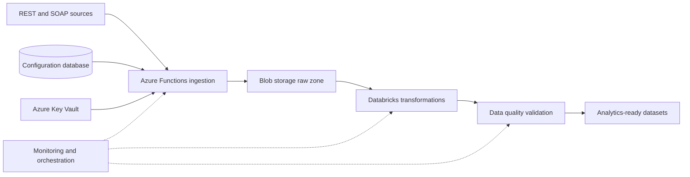

# Cloud Data Integration Platform

A multi-source data engineering platform that combines configurable API ingestion, distributed transformation, validation, and cloud storage for analytics-ready data delivery.

## Problem solved

Operational data arrives through different APIs, authentication methods, schemas, and schedules. Point solutions become difficult to extend and monitor. This architecture standardizes how new sources authenticate, ingest, transform, validate, and land data while keeping source-specific behavior isolated.

## Architecture

## Technology

.NET 6 · C# · Azure Functions · Python · PySpark · Databricks · Azure Blob Storage · Azure SQL · Azure Key Vault · CI/CD

## Engineering highlights

- Configuration-driven ingestion supports multiple source systems.
- Dependency injection isolates authentication and API client implementations.
- Raw responses land before transformation to preserve traceability.
- Distributed Python jobs standardize and enrich source data.
- Dedicated validation checks data quality before downstream use.
- Secrets remain in managed cloud storage rather than code or pipeline files.

## Documentation

- [Platform architecture](docs/architecture.md)
- [Extensibility model](docs/extensibility.md)
- [Security boundaries](docs/security.md)

> This is a sanitized architecture showcase. Customer source code, configuration, data, recordings, and credentials are not included.
