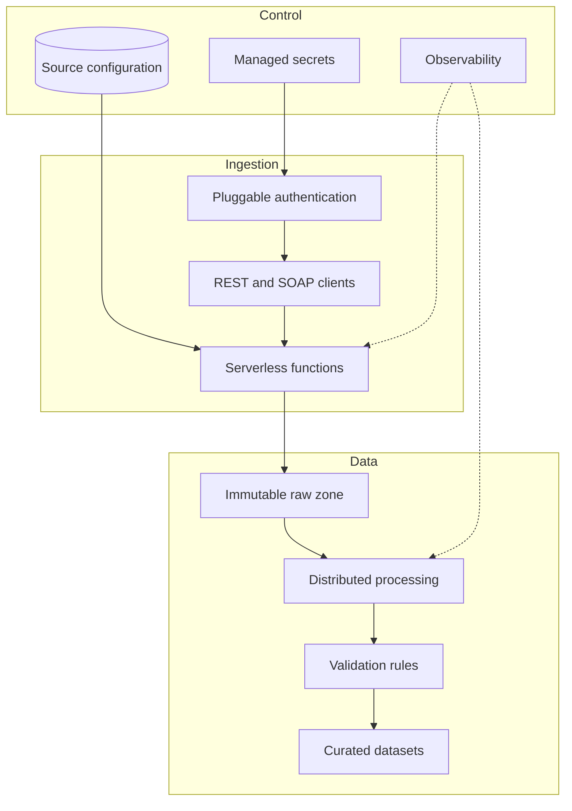

# Platform architecture

The platform separates ingestion, storage, transformation, and validation so each layer can scale and fail independently.

The ingestion service resolves source configuration and authentication at runtime. Raw payloads are stored before distributed jobs apply schema and business transformations. Validation is a separate gate before curated delivery.
